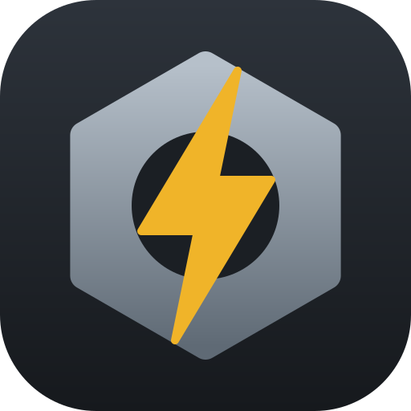
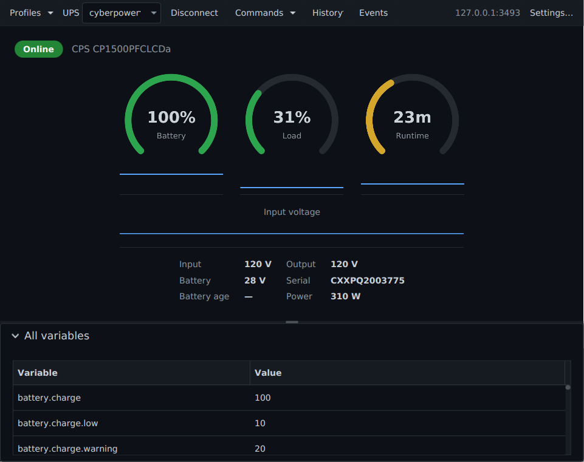

# Nux



[](https://github.com/adriandeleon/nux/actions/workflows/ci.yml)
[](LICENSE)


[](https://github.com/adriandeleon/nux/releases/latest)
[](https://github.com/adriandeleon/nux/releases)
[](https://github.com/adriandeleon/nux/actions/workflows/release.yml)
[](https://github.com/adriandeleon/nux/stargazers)

A simple, powerful, multiplatform client for
[**Network UPS Tools**](https://networkupstools.org/) (NUT), built with **JDK 25**,
**JavaFX 26** and **Maven**. *Nux* is Latin for "nut."

Nux is a pure network client: it speaks the [NUT network
protocol](https://networkupstools.org/docs/developer-guide.chunked/net-protocol.html)
(TCP 3493) directly to `upsd`, so it runs on Linux, macOS, and Windows without any
drivers — the NUT server stays wherever the UPS is plugged in.

Nux is an independent client, not affiliated with or endorsed by the NUT project.
It is built with the help of AI coding tools.

📥 **Downloads:** [latest release](https://github.com/adriandeleon/nux/releases/latest)
— `.deb` / `.rpm` (Linux x64 + arm64), `.dmg` (macOS Intel + Apple silicon), `.msi`
(Windows). Linux and macOS are confirmed working on real hardware; the Windows
installer builds in CI but has not been run by anyone yet.

Installers are **unsigned**, so first launch needs a nudge: on macOS right-click
the app and choose *Open* (or `xattr -d com.apple.quarantine /Applications/Nux.app`),
and on Windows click through the SmartScreen warning. Signing is on the roadmap.

The interface speaks **six languages** — see [Languages](#languages).



## Status

Working: connect to a `upsd`, pick a UPS, live dashboard (status pill,
battery/load/runtime gauges with history sparklines, an input-voltage strip,
voltages) polling every 5 s with automatic reconnect, a raw variables table,
**connection profiles + persisted config with auto-connect on launch**
(`~/.nux/config.properties`), and **desktop notifications** on power events
(on battery / low battery / power restored / replace battery / forced
shutdown, plus lost/restored server contact) via `notify-send` on Linux
(falling back to `gdbus` when libnotify isn't installed) and `osascript` on
macOS (Windows raises them through the tray icon, which is its native path).
Also: **instant commands** (`INSTCMD` — beeper toggle, battery self-test, …)
from a Commands menu with confirmation and session-cached authentication,
**STARTTLS** (per-connection TLS toggle), a **settings window**
(`Ctrl/Cmd+,`) for connection/tray/notification/language options, a **command
palette** (`Ctrl/Cmd+Shift+P`), and a **selectable tray metric**
(battery % / load % / runtime minutes).

Beyond the live view it keeps **persistent history** (charts over the last
hour to 30 days, with kWh and cost estimates), a **persistent event log**
(exportable as CSV), **battery age/health** tracking, an editor for the UPS's
**settable variables** (`upsrw`), **scheduled battery self-tests**, a
**multi-UPS overview** for servers with more than one UPS, **command
tracking** (NUT 2.8 — reports what the UPS actually did, not just that the
request was accepted), and **LAN discovery** of NUT servers.

It also **starts with your session** and keeps a **single instance** —
launching Nux again raises the running window instead of starting a rival copy
polling the same UPS.

## Languages

The interface is available in **English, Spanish, French, German, Portuguese
and Italian**:

| | | |
|---|---|---|
| 🇬🇧 English | 🇪🇸 Español | 🇫🇷 Français |
| 🇩🇪 Deutsch | 🇵🇹 Português | 🇮🇹 Italiano |

Nux follows your system language when it is one of these, and falls back to
English otherwise. To choose explicitly, use **Settings → General → Language**
(*System default* goes back to following the system);
the change applies on the next launch, because the catalogue is loaded once at
startup. `Locale.setDefault` follows the same choice, so JavaFX's own OK/Cancel
buttons match rather than staying English.

### Adding a language

Translations are plain UTF-8 properties files — no build step, no tooling:

1. Copy `src/main/resources/com/nux/i18n/messages.properties` (the English
   base, which is also the fallback for any key you leave out) to
   `messages_<lang>.properties`.
2. Translate the values, leaving the keys alone.
3. Add the ISO code and the language's own name to `Messages.LANGUAGES`.

`MessagesTest` then holds you to it: every bundled language must define
**exactly** the base key set, no value may be blank, and no translation may
drop a `{0}` placeholder.

> **One trap worth knowing.** In values containing `{0}`, a lone apostrophe is
> an escape character (`MessageFormat`) and silently swallows the placeholder —
> so `l'onduleur … {0}` must be written `l''onduleur … {0}`. This bites French,
> Italian and Portuguese in particular. The test formats every parameterised
> value and fails if its placeholder disappears, so the mistake cannot ship.

Contributions of further languages are welcome.

## Requirements

- JDK 25+ (the Maven wrapper supplies Maven itself)
- A reachable [NUT](https://networkupstools.org/) server (`upsd`)

## Run

```bash
./mvnw javafx:run
```

Tests — pure logic plus headless UI tests (JavaFX 26's built-in headless
platform, so no display or Xvfb is needed):

```bash
./mvnw test                      # everything
./mvnw test -DexcludedGroups=fx  # pure logic only
```

Native package (jlink runtime + jpackage; all dependencies are real JPMS
modules, so no moditect ceremony). The app version is derived from the project
version automatically:

```bash
./mvnw -Pdist package                      # portable app image → target/dist/Nux/
./mvnw -Pdist package -Djpackage.type=DEB  # or RPM / DMG / PKG / MSI / EXE
```

On Linux, a run from the source tree has no installed desktop entry, so the
window shows a generic icon until you register one once:

```bash
scripts/install-dev-desktop.sh
```

## Setting up the NUT server (Linux, CyberPower over USB)

Nux talks to a NUT server; it does not talk to the UPS itself. If you don't have
one yet, install NUT from your distribution and see the project's
[installation guide](https://networkupstools.org/docs/user-manual.chunked/index.html)
and [hardware compatibility list](https://networkupstools.org/stable-hcl.html).
A minimal single-machine setup:

```ini
# /etc/nut/ups.conf
[cyberpower]
    driver = usbhid-ups
    port = auto
    desc = "Desk UPS"
```

```ini
# /etc/nut/nut.conf
MODE=standalone        # or netserver to allow LAN clients
```

Then `sudo systemctl enable --now nut-server` and check with
`upsc cyberpower@localhost`.

To run instant commands (beeper toggle, self-test) Nux needs a `upsd.users`
entry with `instcmds` permission:

```ini
# /etc/nut/upsd.users
[nuxuser]
    password = changeme
    instcmds = ALL
```

### TLS

The TLS checkbox in Settings → Connection upgrades the connection with the NUT `STARTTLS`
command; the server needs `CERTFILE` configured in `upsd.conf`. Certificates
are verified against the system truststore by default. For the common
self-signed upsd cert, set `tlsTrustAll=true` by hand in
`~/.nux/config.properties` — that encrypts the wire without authenticating the
server, which is why there's deliberately no UI checkbox for it.

## Architecture

- `com.nux.protocol` — pure, unit-tested core: line tokenizer/parsers
  (`NutParser`), status decoding (`UpsStatus`), transition alerts
  (`StatusTransitions`), snapshot model (`UpsSnapshot`), and the blocking
  socket client (`NutClient`).
- `com.nux.config` — pure, unit-tested `Config`/`Profile` + `ConfigStore`
  (properties file, atomic writes, defaults on missing/malformed).
- `com.nux.service` — `PollService` (one daemon thread polls `LIST VAR`,
  posts snapshots to the FX thread with a generation guard, reconnects with
  the poll interval as backoff), `History` (sparkline ring buffer),
  `Notifier` (best-effort OS notifications, off-thread).
- `com.nux.i18n` — `Messages`, the UI string catalogue (UTF-8 properties read
  from this module's own resources, so no `module-info` opens and no encoding
  ambiguity). The pure cores return catalogue *keys* rather than English, so
  status and alert decisions stay testable and language-independent.
- `com.nux.ui` / `com.nux.App` — the JavaFX dashboard (AtlantaFX-themed).

## Roadmap

- [x] Multi-server / multi-UPS profiles, persisted config, auto-connect
- [x] Status-transition desktop notifications (OL → OB, LB, power restored…)
- [x] History sparklines (charge/load/runtime + input voltage)
- [x] `INSTCMD` support (beeper toggle, battery self-test) with auth
- [x] STARTTLS (verified by default; `tlsTrustAll` config escape hatch)
- [x] jpackage native packaging (`-Pdist`, APP_IMAGE/DEB/RPM/DMG/MSI)
- [x] App icon (`branding/nux.svg`, PNGs via `java scripts/gen_icon.java`)
- [x] Tray icon with charge % — SNI (StatusNotifierItem over D-Bus) on Linux
      (KDE native; GNOME via the AppIndicator extension; Wayland OK), AWT on
      Windows/macOS; click restores the window (see
      `docs/tray-icon-research.md`; disable with `tray=false` in the config)
- [x] Tray context menu (com.canonical.dbusmenu on Linux, AWT PopupMenu
      elsewhere): live status line + Open + Quit. The status line also stands
      in for the tooltip on GNOME, whose AppIndicator extension doesn't render
      SNI tooltips (KDE shows them)
- [x] Close-to-tray (window close hides; tray-menu Quit exits;
      `closeToTray=false` restores plain close-means-quit)
- [x] Release CI: a `v*` tag builds DEB/RPM (Linux x64), DEB (Linux arm64),
      DMG (macOS x64 + arm64), MSI (Windows) and attaches them, with
      checksums, to a GitHub release (`.github/workflows/release.yml`;
      installers are unsigned — signing/notarization is a follow-up)
- [x] Windows notifications (via the tray icon — Windows has no `notify-send`
      equivalent)
- [x] Start at login, and single-instance (a second launch raises the running
      window)
- [x] Multi-language UI: English, Spanish, French, German, Portuguese, Italian
- [ ] Signed and notarised installers (needs an Apple Developer ID and a
      Windows code-signing certificate)
- [ ] Package-manager distribution (Homebrew cask, winget, Flatpak/AppImage)

## Project files

- [CHANGELOG.md](CHANGELOG.md) — release history
- [TODO.md](TODO.md) — planned work and known gaps
- [AUTHORS](AUTHORS) — authors and acknowledgements
- [NOTICE](NOTICE) — third-party components and their licenses
- [docs/tray-icon-research.md](docs/tray-icon-research.md) — why the Linux tray
  is a hand-rolled StatusNotifierItem implementation

## License

[MIT](LICENSE) — copyright (c) 2026 Adrián Arturo De León Saldivar.

Nux depends on components under their own licenses (OpenJFX under GPLv2 with the
Classpath Exception; AtlantaFX, dbus-java and SLF4J under MIT) — see [NOTICE](NOTICE).
